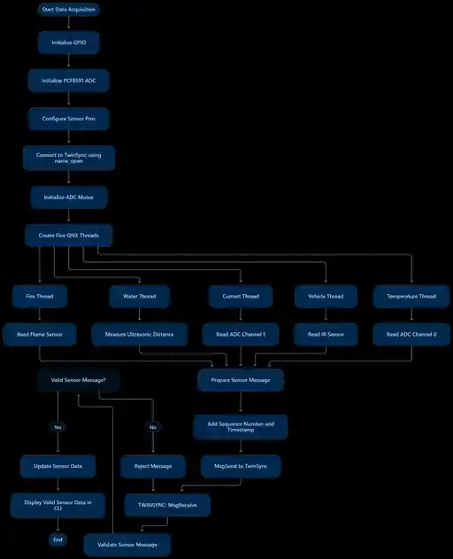

# CitySync RT+ — QNX Real-Time City Monitoring and Digital Twin Synchronization

CitySync RT+ is a QNX SDP 8.0 application targeting Raspberry Pi 4. It collects data from five sensor domains, transfers updates through QNX native message passing, maintains a synchronized latest-state view, detects stale or failed sensor data, reports timing performance, and controls three independent LED alert outputs.

> **Project status:** The repository contains the updated source and project documentation. Compilation and behaviour must be verified on the target hardware. Publishing the source is not proof of a successful build, hardware validation, or measured real-time performance.

## Project goals
- Acquire sensor readings from Fire, Water, Current/Energy, Traffic, and Temperature.
- Transfer messages from DataAcquisition to TwinSync.
- Validate messages and reject invalid or out-of-order updates.
- Maintain latest subsystem and Fire states.
- Distinguish UNAVAILABLE, ACTIVE, and STALE data.
- Report sensor faults and timing performance.
- Drive three independent local LED alerts.

## Project images
### Circuit wiring

### Data acquisition flowchart


## Architecture

The current implementation has **two application processes**:

1. **DataAcquisition** — initializes GPIO/I2C, creates five sensor worker threads, reads sensors, controls LEDs, timestamps readings, and sends messages.
2. **TwinSync** — registers the QNX named channel, receives and validates messages, maintains subsystem and Fire state, monitors freshness, and prints dashboard/performance output.

DataAcquisition has its main thread plus five sensor threads: Fire, Water, Current, Vehicle, and Temperature. TwinSync handles messages and timer pulses in its main receive loop. LED outputs are driven inside existing acquisition threads, not extra processes or worker threads.

## Sensor mapping

| Subsystem | Input | Connection | Data |
|---|---|---|---|
| Fire | Flame sensor | GPIO27 | FIRE / CLEAR |
| Water | HC-SR04 | TRIG GPIO23, ECHO GPIO24 | Distance in cm |
| Energy / Current | PCF8591 AIN1 + potentiometer | AIN1 | Simulated current in mA |
| Traffic | IR sensor | GPIO17 | Vehicle count |
| Environment | LM35 via PCF8591 | AIN0 | Temperature °C |

The potentiometer is a test input scaled in software to simulated 0–5000 mA; it is not a calibrated current sensor. HC-SR04 reports distance, not water level. Calculating tank water height requires a known reference height and calibration. Flame and IR inputs are configured active-low.

## LED alert outputs

| LED | BCM GPIO | Physical pin | ON condition |
|---|---:|---:|---|
| LED1 — Fire | GPIO5 | 29 | Flame sensor indicates detection |
| LED2 — Water / distance | GPIO6 | 31 | Valid measured ultrasonic distance > 30 cm |
| LED3 — Current | GPIO13 | 33 | Simulated current > 1500 mA |

A dedicated QNX mutex protects the independent LED states and GPIO writes. Multiple LEDs may remain ON simultaneously. All outputs initialize OFF and are turned OFF during normal shutdown.

**Threshold interpretation:** LED2 responds to sensor-to-surface distance greater than 30 cm, not water height greater than 30 cm. For a sensor mounted above a tank, greater distance normally means a lower water surface. Convert distance using tank geometry before presenting this as a high-water-level alarm. LED3 uses potentiometer-derived simulated current, not calibrated current measurement.

### LED wiring
Use one 2.2 kΩ series resistor per LED:
- GPIO5 → 2.2 kΩ → LED1 anode; cathode → GND.
- GPIO6 → 2.2 kΩ → LED2 anode; cathode → GND.
- GPIO13 → 2.2 kΩ → LED3 anode; cathode → GND.

A 2.2 kΩ resistor is a conservative indicator choice for 3.3 V GPIO; brightness depends on the LED. Never connect an LED directly to GPIO without a series resistor.

See [LED indicator logic](docs/led-indicator-logic.md) and [hardware connections](docs/hardware-connections.md).

## Sampling and scheduling configuration

| Sensor thread | Sampling interval [Cfg] | Requested SCHED_FIFO priority [Cfg] |
|---|---:|---:|
| Fire | 100 ms | 60 |
| Water | 300 ms | 55 |
| Current | 200 ms | 50 |
| Vehicle | 500 ms | 45 |
| Temperature | 1000 ms | 40 |
| TwinSync main receive loop | — | 63 |

The TwinSync monitor timer sends a pulse with priority 10. This is pulse delivery priority, not a separate application thread. Monitoring/diagnostics priority constants do not mean extra worker threads currently exist. Priority values are requests; confirm success from target startup output. The configured 20 ms latency threshold is a monitoring target, not a guaranteed worst-case bound.

## QNX message protocol

| Message | Structure | Purpose |
|---|---|---|
| CITYSYNC_MSG_UPDATE | CitySyncMessage | Traffic, Current, Water-distance, Temperature |
| CITYSYNC_MSG_UPDATE_FLAME | CitySyncFlameMessage | Dedicated Flame detected / clear update |
| CITYSYNC_MSG_SENSOR_STATUS | CitySyncSensorStatusMessage | OK, FAILED, Water NO_ECHO |
| CITYSYNC_MSG_GET_STATE | CitySyncRequest | Latest-state snapshot request |

DataAcquisition connects with name_open() and sends with MsgSend(). TwinSync registers the channel with name_attach(), receives with MsgReceive(), and replies with MsgReply() or MsgError(). The updated TwinSync includes a dedicated Flame message handler and maintains Fire state separately.

## QNX APIs used

| API | Purpose |
|---|---|
| ThreadCreate(), ThreadJoin() | Create / join acquisition worker threads |
| SyncTypeCreate(), SyncMutexLock(), SyncMutexUnlock(), SyncTypeDestroy() | Protect shared ADC and LED state |
| name_open(), name_attach(), name_close(), name_detach() | Named channel lifecycle |
| MsgSend(), MsgReceive(), MsgReply(), MsgError() | Inter-process messages |
| ClockTime() | Monotonic timestamp |
| TimerTimeout() | Absolute periodic waits in acquisition threads |
| ConnectAttach(), TimerCreate(), TimerSettime(), TimerDestroy() | TwinSync monitor timer and pulse |
| SchedSet() | Request QNX SCHED_FIFO priority |
| SignalAction() | Handle SIGINT / SIGTERM |

## Fault and freshness states

| State | Meaning |
|---|---|
| UNAVAILABLE | No valid reading received, or a sensor FAILED status |
| ACTIVE | Valid reading within its freshness timeout |
| STALE | Last valid reading exceeded timeout, or Water returned NO_ECHO |

Configured stale timeouts [Cfg]: Traffic 1500 ms, Fire 500 ms, Current 600 ms, Water 900 ms, Temperature 3000 ms. A Water NO_ECHO does not prove physical disconnection: TwinSync retains the last valid distance and marks it STALE, or UNAVAILABLE if there has never been a valid reading.

## Performance monitoring

TwinSync reports Updates, MinLat, AvgLat, MaxLat, MaxJit, GapMiss, LatMiss, and Rejected. The 20 ms latency threshold is configured; insert actual Raspberry Pi measurements and QNX Momentics System Profiler evidence before making performance claims.

## Repository layout

```text
citysync/
├── src/
│   ├── DataAcquisition.c
│   ├── TwinSync.c
│   ├── pcf8591_adc.c
│   └── rpi_gpio_qnx.c
├── include/
│   ├── citysync_types.h
│   ├── pcf8591_adc.h
│   ├── rpi_gpio_qnx.h
│   └── README.md
└── docs/
    ├── architecture/system-architecture.md
    ├── data-acquisition-flowchart.md
    ├── hardware-connections.md
    ├── led-indicator-logic.md
    └── images/
        ├── circuit-wiring.webp
        └── data-acquisition-flowchart.webp
```

## Hardware safety

HC-SR04 ECHO can output 5 V, while Raspberry Pi GPIO inputs are not 5 V tolerant. Use a suitable voltage divider or logic-level shifter before GPIO24. Use common ground and verify module supply requirements.

## Build and run

Build with the QNX SDP 8.0 toolchain configured for the target architecture. Adjust compiler variant, include paths, and link options to match Momentics.

```sh
qcc -Vgcc_ntoaarch64le -Iinclude -c src/TwinSync.c -o TwinSync.o
qcc -Vgcc_ntoaarch64le -Iinclude -c src/DataAcquisition.c -o DataAcquisition.o
```

Start TwinSync first so it registers CitySyncTwin, then start DataAcquisition.

## Validation checklist
- [ ] Build both programs with the QNX SDP 8.0 toolchain.
- [ ] Confirm GPIO and I2C initialization on Raspberry Pi 4.
- [ ] Confirm PCF8591 communication on /dev/i2c1.
- [ ] Confirm all five acquisition threads start.
- [ ] Confirm TwinSync handles all four message types.
- [ ] Test LED1 on GPIO5 with Flame clear and detected states.
- [ ] Test LED2 on GPIO6 below, at, and above 30 cm.
- [ ] Test LED3 on GPIO13 below, at, and above the simulated 1500 mA threshold.
- [ ] Confirm multiple LEDs can remain ON simultaneously.
- [ ] Verify NO_ECHO, STALE, UNAVAILABLE, and FAILED handling.
- [ ] Capture actual Momentics System Profiler evidence and Raspberry Pi performance results.

## License
No licence has been selected for this repository yet.
