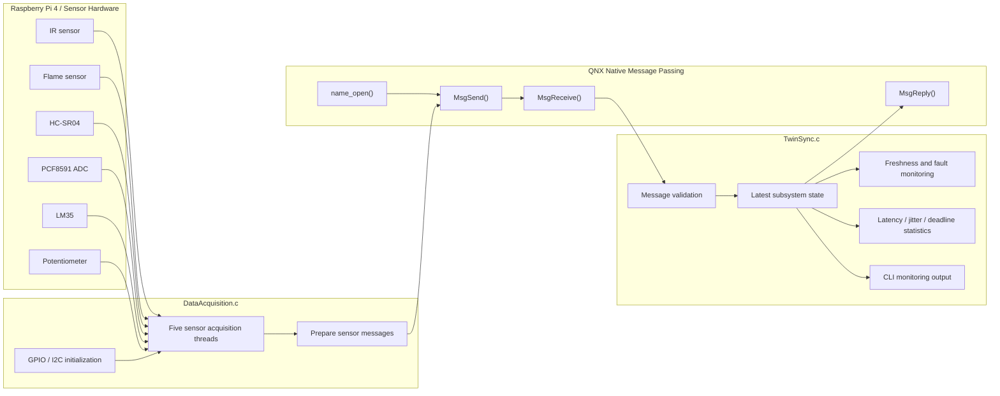

# CitySync RT+ — QNX Real-Time Sensor Monitoring and Digital Twin Synchronization

CitySync RT+ is a real-time sensor-monitoring and synchronization project targeting **QNX SDP 8.0 on Raspberry Pi 4**. It acquires physical sensor data, transports readings through QNX Native Message Passing, maintains a latest-state representation, and reports sensor freshness, faults, and timing performance.

> **Project status:** This repository packages the project sources and documentation. Build and hardware behavior must be verified on the target Raspberry Pi 4 running QNX SDP 8.0. Inclusion here does not imply successful compilation or hardware validation.

## Project goals
- Acquire readings from five sensor domains.
- Send updates from the acquisition process to TwinSync.
- Validate message type, size, subsystem ID, validity, finite values, and sequence ordering.
- Maintain the latest accepted state for each subsystem.
- Distinguish `UNAVAILABLE`, `ACTIVE`, and `STALE` data.
- Report sensor faults and synchronization performance.

## Architecture



### DataAcquisition.c
Initializes GPIO and PCF8591/I2C interfaces, opens the named TwinSync connection with `name_open()`, starts sensor threads, samples sensors at configured intervals, and sends messages containing subsystem ID, sequence, timestamp, value, and validity.

### TwinSync.c
Registers the `CitySyncTwin` channel with `name_attach()`, receives messages using `MsgReceive()`, validates input, rejects malformed or out-of-order updates, maintains the latest state, refreshes freshness, reports performance, and answers `CITYSYNC_MSG_GET_STATE` requests.

## Sensor mapping

| Subsystem ID | Domain | Sensor/input | Meaning |
|---:|---|---|---|
| 1 | Traffic | IR sensor | Vehicle detection |
| 2 | Energy | PCF8591 AIN1 + potentiometer | Simulated current input |
| 3 | Water | HC-SR04 ultrasonic sensor | Distance; calibration needed for water level |
| 4 | Environment | LM35 via PCF8591 AIN0 | Temperature |
| 5 | Fire | Flame sensor | Fire detection |

The current input is potentiometer-based simulation, not a calibrated current measurement. HC-SR04 measures distance; water level requires a known tank reference and calibration.

## Sampling and timing configuration

| Domain | Sampling interval | Proposed priority | Deadline tolerance | Stale timeout |
|---|---:|---:|---:|---:|
| Fire | 100 ms | 60 | 50 ms | 500 ms |
| Water | 300 ms | 55 | 50 ms | 900 ms |
| Energy/current | 200 ms | 50 | 50 ms | 600 ms |
| Traffic/vehicle | 500 ms | 45 | 50 ms | 1500 ms |
| Environment/temperature | 1000 ms | 40 | 100 ms | 3000 ms |
| TwinSync | — | 35 | — | — |
| Monitoring | — | 30 | — | — |
| Diagnostics | — | 10 | — | — |

These are configured/proposed values, not proof that QNX granted the priorities. Verify the effective scheduling policy and runtime priority. The 20 ms latency target is a monitoring threshold, not a guaranteed worst-case bound.

## Fault and freshness states
- **UNAVAILABLE:** no valid reading has been accepted, or a failed state has been reported.
- **ACTIVE:** a valid reading exists and is within its freshness timeout.
- **STALE:** a previously accepted reading exceeded its timeout, or an ultrasonic `NO_ECHO` status marked it stale.

A stale value does not necessarily mean the sensor is physically disconnected. No-echo can result from range, alignment, surface, wiring, or sensor conditions.

## Message protocol

Defined in `include/citysync_types.h`.

| Message | Structure | Purpose |
|---|---|---|
| `CITYSYNC_MSG_UPDATE` | `CitySyncMessage` | Standard subsystem reading |
| `CITYSYNC_MSG_GET_STATE` | `CitySyncRequest` | Latest state request |
| `CITYSYNC_MSG_UPDATE_FLAME` | `CitySyncFlameMessage` | Dedicated flame message type |
| `CITYSYNC_MSG_SENSOR_STATUS` | `CitySyncSensorStatusMessage` | Sensor health/error notification |

TwinSync currently processes standard updates, sensor-status messages, and state requests. The current DataAcquisition implementation sends Fire readings using `CITYSYNC_MSG_UPDATE_FLAME`, but the TwinSync receive loop does not yet implement that message handler. Fire updates therefore require an integration fix before end-to-end operation. Latency calculations require acquisition and TwinSync timestamps to use the same `CLOCK_MONOTONIC` clock domain.

## Repository layout

```text
citysync/
├── src/
│   ├── DataAcquisition.c
│   ├── TwinSync.c
│   ├── pcf8591_adc.c
│   └── rpi_gpio_qnx.c
├── include/
│   ├── citysync_types.h
│   ├── pcf8591_adc.h
│   ├── rpi_gpio_qnx.h
│   └── README.md
├── docs/
│   ├── architecture/system-architecture.md
│   ├── data-acquisition-flowchart.md
│   └── hardware-connections.md
├── .gitignore
└── README.md
```

## QNX APIs and concepts

| API | Role |
|---|---|
| `name_attach()` | Register TwinSync named channel |
| `name_open()` | Open named channel from acquisition |
| `MsgSend()` | Send sensor messages |
| `MsgReceive()` | Receive messages in TwinSync |
| `MsgReply()` | Reply to messages |
| `MsgError()` | Return an error to sender |
| `ConnectAttach()` | Create connection for timer pulses |
| `timer_create()`, `timer_settime()` | Periodic monitor timer |
| `clock_gettime(CLOCK_MONOTONIC, ...)` | Monotonic time source |
| `signal()` | Graceful stop request for SIGINT/SIGTERM |

The code also uses standard C library functions.

## Hardware connections
See [hardware-connections.md](docs/hardware-connections.md) for the pin table and electrical notes. The wiring diagram and data-acquisition flowchart PNG files are included in the downloadable project ZIP under `docs/images/`; they have not yet been committed to this GitHub repository.

**Electrical warning:** HC-SR04 ECHO is a 5 V signal, while Raspberry Pi GPIO inputs are not 5 V tolerant. Use a suitable voltage divider or logic-level shifter before GPIO24. Connect grounds together and verify each module's supply requirements.

## Build and run notes

Build using the QNX SDP 8.0 toolchain configured for the target architecture. Example compilation commands (adjust compiler variant and flags to match your installation):

```sh
qcc -Vgcc_ntoaarch64le -Iinclude -c src/TwinSync.c -o TwinSync.o
qcc -Vgcc_ntoaarch64le -Iinclude -c src/DataAcquisition.c -o DataAcquisition.o
```

Link against the required QNX libraries and target-specific driver support. Do not treat a Linux GCC build as a QNX validation.

Run order:
1. Boot QNX on Raspberry Pi 4 and confirm GPIO/I2C access.
2. Start TwinSync so it registers `CitySyncTwin`.
3. Start DataAcquisition.
4. Observe sensor status, fault monitoring, and performance reports.

## Validation checklist
- [ ] QNX boots on Raspberry Pi 4.
- [ ] GPIO and I2C access is available.
- [ ] PCF8591 responds at its configured I2C address.
- [ ] TwinSync registers `CitySyncTwin`.
- [ ] DataAcquisition connects and sends valid sensor updates.
- [ ] Disconnecting a sensor produces the expected unavailable/stale status.
- [ ] Invalid and out-of-order messages are rejected.
- [ ] Timing metrics are checked under target hardware load.

## License
No licence has been selected for this repository yet.
