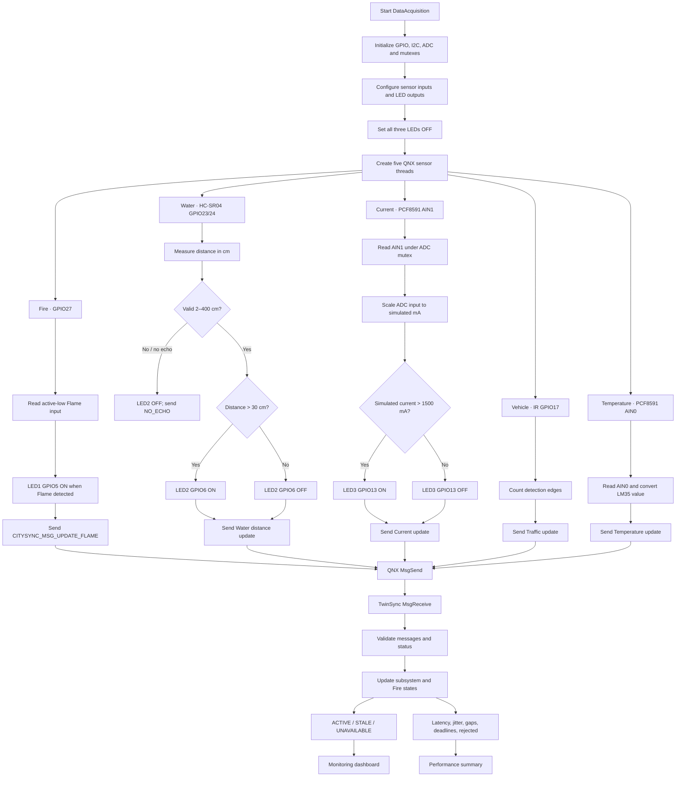

# CitySync RT+ — Updated Data Acquisition Flow

The current program has five sensor threads. Fire, Water, and Current worker threads also control local LED outputs; the LEDs do not add separate processes or worker threads.

## Sampling intervals [Cfg]

| Thread | Interval |
|---|---:|
| Fire | 100 ms |
| Current | 200 ms |
| Water | 300 ms |
| Vehicle | 500 ms |
| Temperature | 1000 ms |

## LED control summary

- Flame detection (active-low input) turns LED1 GPIO5 ON.
- Valid ultrasonic distance greater than 30 cm turns LED2 GPIO6 ON; invalid/no echo clears it.
- Simulated current greater than 1500 mA turns LED3 GPIO13 ON; ADC failure clears it.
- The states are protected by a QNX mutex, so multiple LEDs can stay ON independently.
- All LEDs initialize OFF and turn OFF on normal shutdown.

The ultrasonic threshold is a distance comparison, not a water-height measurement. The current threshold is based on a potentiometer-derived simulated value.

## TwinSync receive path

TwinSync handles CITYSYNC_MSG_UPDATE, CITYSYNC_MSG_UPDATE_FLAME, CITYSYNC_MSG_SENSOR_STATUS, and CITYSYNC_MSG_GET_STATE. It maintains Fire state separately and includes Fire in the dashboard and performance summary.
