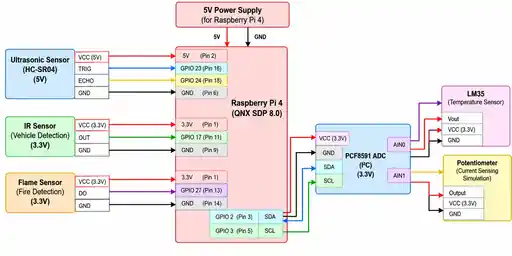

# CitySync RT+ — Hardware Connections

## Sensor connections

| Component | Signal | BCM GPIO / Interface | Physical pin |
|---|---|---:|---:|
| HC-SR04 | VCC | 5 V | 2 |
| HC-SR04 | TRIG | GPIO23 | 16 |
| HC-SR04 | ECHO | GPIO24 | 18 |
| HC-SR04 | GND | GND | 6 |
| IR sensor | VCC | 3.3 V | 1 |
| IR sensor | OUT | GPIO17 | 11 |
| IR sensor | GND | GND | 9 |
| Flame sensor | VCC | 3.3 V | 1 |
| Flame sensor | DO | GPIO27 | 13 |
| Flame sensor | GND | GND | 14 |
| PCF8591 | VCC | 3.3 V | 1 |
| PCF8591 | GND | GND | 9 |
| PCF8591 | SDA | GPIO2 / SDA | 3 |
| PCF8591 | SCL | GPIO3 / SCL | 5 |

## Analog inputs

| PCF8591 channel | Device | Purpose |
|---|---|---|
| AIN0 | LM35 Vout | Temperature |
| AIN1 | Potentiometer output | Simulated current input |

The potentiometer is a variable test input, not a calibrated current sensor.

## LED outputs

| LED | BCM GPIO | Physical pin | ON condition |
|---|---:|---:|---|
| LED1 — Fire | GPIO5 | 29 | Flame detection |
| LED2 — Water / distance | GPIO6 | 31 | Valid measured HC-SR04 distance > 30 cm |
| LED3 — Current | GPIO13 | 33 | Simulated current > 1500 mA |

### LED wiring

Use one 2.2 kΩ resistor per LED:
- GPIO5 → 2.2 kΩ → LED1 anode; LED1 cathode → GND.
- GPIO6 → 2.2 kΩ → LED2 anode; LED2 cathode → GND.
- GPIO13 → 2.2 kΩ → LED3 anode; LED3 cathode → GND.

A 2.2 kΩ resistor is a conservative indicator choice for a 3.3 V GPIO output; brightness depends on the LED. Never connect an LED directly to GPIO without a series resistor. The three indicators are independent and can be ON simultaneously.

## Threshold interpretation

- LED1 uses an active-low flame input.
- LED2 compares distance, not actual water height. For an ultrasonic sensor mounted above a tank, greater distance generally indicates a lower water surface.
- LED3 responds to potentiometer-derived simulated current, not real calibrated current.

## Electrical safety

HC-SR04 ECHO can output 5 V, while Raspberry Pi GPIO inputs are not 5 V tolerant. Use a voltage divider or level shifter before GPIO24. Use a common ground and verify all module voltage requirements before powering the circuit.
